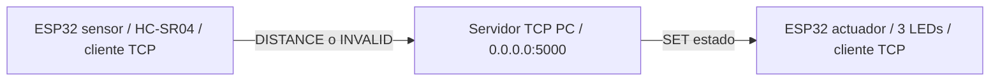
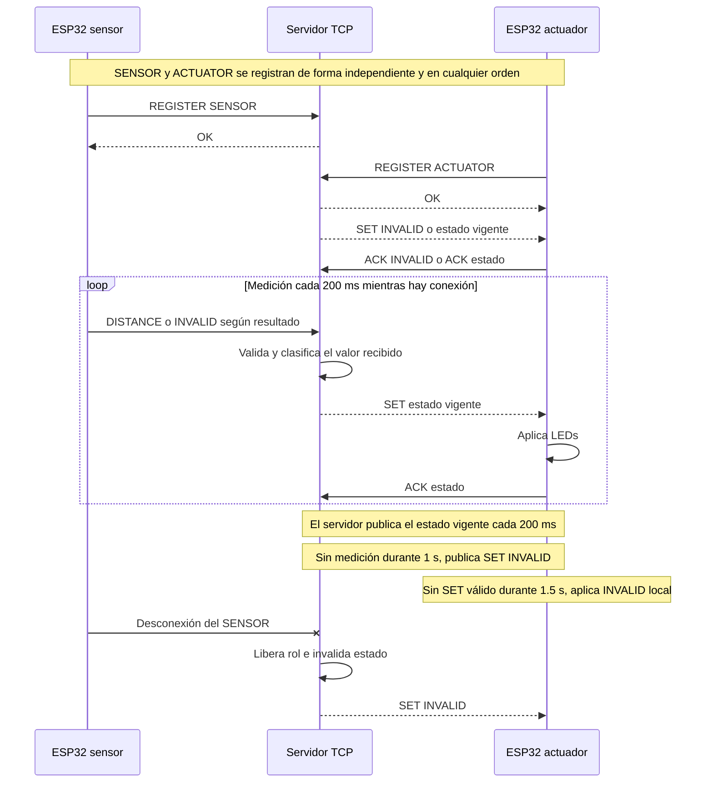
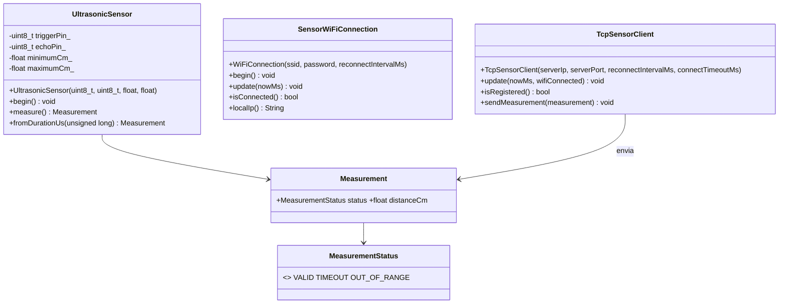
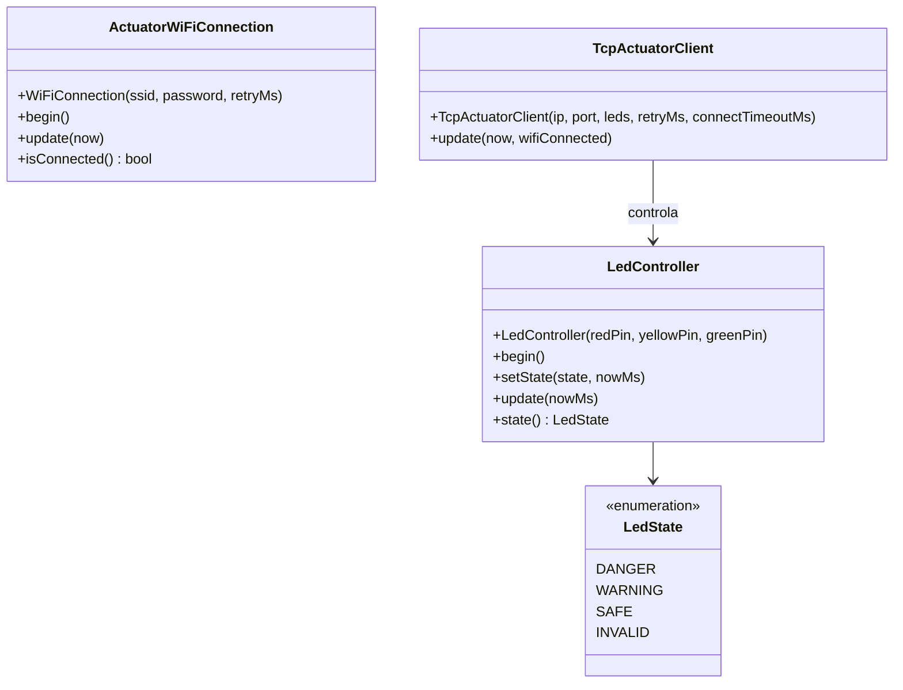
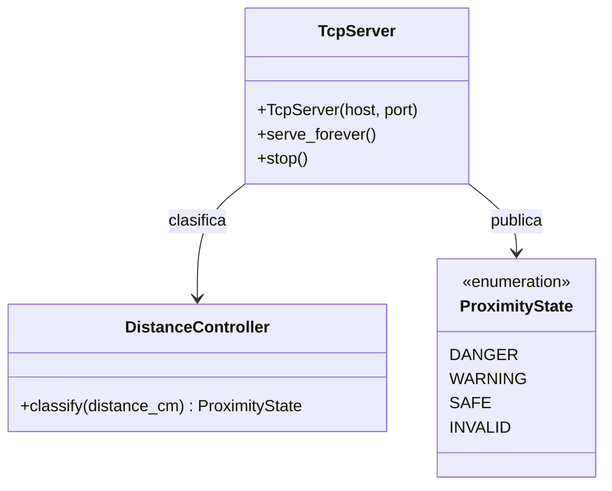

# Informe técnico — Práctica 2

> **Estado del documento:** los firmwares de sensor y actuador, incluidos WiFi/TCP, están implementados y cuentan con compilación PlatformIO registrada. El servidor TCP cuenta con validación automatizada local. Unity en placa, pruebas físicas e integración real siguen pendientes.

## Integrantes y responsabilidades iniciales

| Integrante | Responsabilidad inicial | Evidencia futura |
|---|---|---|
| Nombre pendiente | ESP32 sensor | Código, montaje, logs y pruebas del sensor |
| Nombre pendiente | ESP32 actuador | Código, montaje, evidencia LED y pruebas del actuador |
| Nombre pendiente | Servidor TCP | Código, logs del servidor y pruebas de protocolo |

## 1. Requerimientos funcionales y no funcionales

| ID | Origen | Requisito | Responsable | Prueba prevista | Estado |
|---|---|---|---|---|---|
| RF1 | Práctica 2 §3.1; P1 RF-01 | Medir distancia con HC-SR04 en cm. | ESP32 sensor | M-02, M-03, M-06, M-09 | Pendiente |
| RF2 | Práctica 2 §3.1; P1 RF-02 | El servidor clasifica sin redondear: DANGER `[2,20)`, WARNING `[20,50)`, SAFE `[50,100]`; fuera de rango es INVALID. | Servidor TCP | M-02 | Pendiente |
| RF3 | Práctica 2 §3.1; P1 RF-03/RF-05 | El actuador representa solo el `SET` recibido: rojo 150/150 ms, amarillo 500/500 ms, verde fijo; INVALID apaga todos. | ESP32 actuador | M-02, M-04, M-05, M-08, M-09 | Pendiente |
| RF4 | Práctica 2 §3.1 | Sensor y actuador se conectan por WiFi al servidor mediante TCP y el protocolo definido. | Tres componentes | M-01, M-05, M-08, M-11 | Pendiente |
| RF5 | P1 RF-04 | La operación debe continuar durante muestreo y parpadeo. | Sensor y actuador | M-04, M-05, M-07 | Pendiente |
| RF6 | Decisión del grupo | El servidor es la única autoridad de clasificación; el sensor informa y el actuador no reclasifica. | Servidor TCP | M-01, M-02 | Pendiente |
| RF7 | Decisión del grupo | Mensaje malformado: responder `ERROR <reason>`, registrar el evento, conservar conexión y no ejecutar acción. | Servidor TCP | M-11 | Pendiente |
| RNF1 | Práctica 2 §3.2 | Estabilidad: operación continua por al menos 10 min sin reinicio ni bloqueo. | Tres componentes | M-07 | Pendiente |
| RNF2 | Práctica 2 §3.2 | Exactitud: error máximo ≤ ±3 cm dentro de 2–100 cm frente a referencia física. | ESP32 sensor | M-03 | Pendiente |
| RNF3 | Práctica 2 §3.2 | Respuesta extremo a extremo ≤ 1 s, sensor → servidor → actuador. | Tres componentes | M-08 | Pendiente |
| RNF4 | Decisión del grupo; Práctica 2 §3.2 | Frecuencia objetivo de 5 lecturas/s (una lectura cada 200 ms); supera la referencia docente de ≥ 2 lecturas/s. | ESP32 sensor | M-06 | Pendiente |

Las fronteras son contiguas: 2.00 cm y 100.00 cm son válidas; 20.00 cm es WARNING y 50.00 cm es SAFE. No se redondea antes de clasificar.

## 2. Análisis y diseño

El sensor mide y comunica `DISTANCE` o `INVALID`; el servidor valida, clasifica, registra y envía `SET`; el actuador únicamente traduce el comando válido a LEDs. Ambos clientes reintentan conectar cada 2 s. Ante ausencia de datos del sensor durante 1 s, el servidor envía `SET INVALID` y publica el estado vigente cada 200 ms. Si el actuador no recibe comandos por 1,5 s, adopta INVALID local y apaga LEDs.

### 2.1 Arquitectura general del sistema

### 2.2 Circuito del ESP32 sensor con HC-SR04

El diagrama identifica conexiones lógicas; antes de energizar se deben verificar las etiquetas GPIO serigrafiadas del modelo físico de ESP32 DevKit utilizado.

### 2.3 Circuito del ESP32 actuador con tres LEDs

El ánodo de cada LED queda hacia su resistencia de 220 Ω y el cátodo hacia GND común. Las etiquetas GPIO deben verificarse en la placa antes del montaje.

### 2.4 Diagrama de secuencia de comunicación TCP

El `OK` precede al `SET` inicial del ACTUATOR. El servidor envía el estado vigente al registrar ese rol, incluso si el SENSOR aún no se registró. Las respuestas `ACK` son informativas; la publicación periódica no espera ni reintenta un ACK.

### 2.5 Diagrama de clases del sistema

Los tres diagramas reflejan clases implementadas. `SensorWiFiConnection` y `ActuatorWiFiConnection` representan dos implementaciones homónimas ubicadas en proyectos distintos; no son una clase compartida. Los atributos privados se omiten deliberadamente cuando no son necesarios para explicar relaciones públicas.

Todos los clientes TCP, el actuador y el servidor están implementados. La compilación registrada cubre ambos firmwares; la ejecución Unity en placa y la integración física siguen pendientes.

### 2.6 Configuración TCP y WiFi local

El servidor Python escuchará en `0.0.0.0:5000`; `0.0.0.0` permite aceptar conexiones de la red local, pero los ESP32 deben conectarse a la **dirección IPv4 local de la PC**, nunca a `0.0.0.0`. Esa IP no se fija en el código ni se asocia a una red específica. En Windows se obtiene con `ipconfig`, identificando la dirección IPv4 del adaptador WiFi conectado; en otra plataforma se debe consultar la IPv4 de su interfaz WiFi activa. Si cambia la red o la IP, se actualiza la configuración local de ambos ESP32 antes de cargar el firmware.

Cada integrante prepara su archivo local ignorado por Git en **ambos** proyectos: `ESP32 sensor/include/WiFiSecrets.h` y `ESP32 actuador/include/WiFiSecrets.h`. Para cada uno, copiar su `WiFiSecrets.example.h`, configurar `kWifiSsid`, `kWifiPassword` y `kServerIp` con la IPv4 local real de la PC (nunca `0.0.0.0`), mantener `kServerPort = 5000` y cambiar `kUsingExampleWiFiSecrets` de `true` a `false`. Antes de cargar el firmware, comprobar que los dos ESP32 tienen exactamente la misma IPv4 y el puerto `5000`. `WiFiSecrets.h` está ignorado por Git y no debe añadirse al repositorio ni a evidencias. En Windows, obtener la IPv4 con `ipconfig` en el adaptador WiFi activo; si cambia la red o la IP, actualizar los dos archivos locales.

El firmware conserva `__has_include`: si no existe `WiFiSecrets.h`, usa la plantilla versionada, que solo contiene marcadores `REPLACE_WITH_...`, no secretos, y deja `kUsingExampleWiFiSecrets = true`. En esa modalidad el firmware compila y mantiene sus funciones locales, pero intencionalmente no inicia WiFi ni TCP. Con un `WiFiSecrets.h` local completo y la bandera en `false`, inicia la conexión WiFi/TCP con los valores configurados. Esta comprobación de las dos modalidades se realiza sin hardware con `tests/automated/check_wifi_secrets_config.py`; la conectividad real se valida únicamente durante las pruebas físicas finales.

### 2.7 Protocolo de aplicación

Transporte: TCP sobre WiFi. El servidor escucha en el puerto `5000`. Cada mensaje es una línea de texto UTF-8 terminada en `\n`; se acepta `\r\n` eliminando el `\r` final antes de interpretar la línea. Cada línea tiene un máximo de 128 bytes. Si se supera el máximo, el servidor descarta bytes hasta el siguiente `\n`, responde `ERROR INVALID_FORMAT`, registra el evento y conserva la conexión. Un cliente se identifica primero con `REGISTER SENSOR` o `REGISTER ACTUATOR`; el servidor responde `OK`. Solo se admite un cliente por rol; un segundo cliente del mismo rol se rechaza.

| Emisor → receptor | Mensaje | Significado |
|---|---|---|
| Cliente → servidor | `REGISTER SENSOR` / `REGISTER ACTUATOR` | Registro del rol. Al actuador se le entrega el estado vigente. |
| Sensor → servidor | `DISTANCE <valor>` | Distancia en centímetros: entero o decimal con punto y hasta dos cifras decimales. No se redondea antes de clasificar. |
| Sensor → servidor | `INVALID` | No hay eco o la lectura física no es válida. |
| Servidor → actuador | `SET DANGER` / `SET WARNING` / `SET SAFE` / `SET INVALID` | Estado calculado exclusivamente por el servidor. |
| Actuador → servidor | `ACK <estado>` | Confirmación informativa e idempotente de `DANGER`, `WARNING`, `SAFE` o `INVALID`; el servidor conserva el último `SET` y el último `ACK` para trazabilidad, sin retransmisión ni transición de estado. |
| Servidor → cliente | `OK` | Operación de registro aceptada. |
| Servidor → cliente | `ERROR INVALID_COMMAND` | Comando no reconocido. |
| Servidor → cliente | `ERROR INVALID_DISTANCE` | Valor de `DISTANCE` ausente, no numérico, no finito, con coma o con más de dos cifras decimales. |
| Servidor → cliente | `ERROR INVALID_FORMAT` | Línea incompleta o con formato no válido. |

La gramática del valor es `entero` o `entero.decimal`, con uno o dos dígitos decimales como máximo; el separador es siempre punto. Ejemplos válidos: `2`, `20.5`, `100.00`. Ejemplos que responden `ERROR INVALID_DISTANCE`: `20,5`, `20.123`, `NaN` y `DISTANCE` sin valor. Una distancia numéricamente válida pero fuera de `[2,100]`, como `1.99` o `100.01`, produce `SET INVALID`, no `ERROR INVALID_DISTANCE`.

Antes de registrarse, un cliente no puede enviar comandos de su rol. El registro repetido, mensajes de rol incorrecto —por ejemplo, `DISTANCE` recibido desde ACTUATOR o `ACK` desde SENSOR—, comandos previos al registro y `ACK` con un estado que no pertenece al conjunto definido responden `ERROR INVALID_COMMAND`, se registran y no ejecutan acción. Un `ACK` válido se conserva junto al último `SET`; si ambos difieren, se registra una advertencia porque puede corresponder a una publicación periódica anterior, sin cerrar la conexión ni cambiar el estado. `ERROR INVALID_FORMAT` se reserva para una línea que no respeta la estructura general del protocolo. Un error no modifica el estado y la conexión permanece abierta.

Al iniciar, el estado del servidor es `INVALID`; por tanto, un ACTUATOR que se registre antes de la primera medición recibe `SET INVALID`. Al cerrarse una conexión, el servidor libera inmediatamente el rol asociado. Si era el SENSOR, invalida inmediatamente el estado y publica `SET INVALID` al actuador conectado. Un ACTUATOR que se registre después recibe el estado vigente, incluido INVALID. La máquina de estados de registro y limpieza está en [diagramas/arquitectura.md](diagramas/arquitectura.md#registro-y-limpieza-de-conexión).

### 2.8 Hardware y seguridad eléctrica

El HC-SR04 se alimentará con VCC de 5 V y GND común con el ESP32; TRIG se conecta a GPIO18. Como ECHO puede entregar 5 V, se requiere el divisor: **ECHO → 1 kΩ → GPIO19** y **GPIO19 → 2 kΩ → GND**. En el actuador, rojo, amarillo y verde usarán GPIO25, GPIO26 y GPIO27 respectivamente; cada LED tendrá resistencia de 220 Ω y cátodo a GND. El montaje real, fotos y mediciones se conservarán como evidencia; este documento no afirma que exista un montaje probado.

### 2.9 Diseño estructural implementado

Los clientes WiFi/TCP de Sensor y Actuador, `TcpServer`, `DistanceController` y el parser están implementados. Los diagramas muestran únicamente operaciones públicas verificadas en el código; no atribuyen firmas ni atributos inexistentes.

## 3. Desarrollo e implementación

La primera etapa del sensor se implementó en `ESP32 sensor/`. [UltrasonicSensor.h](ESP32%20sensor/include/UltrasonicSensor.h) define una clase reutilizable que recibe GPIO18 (TRIG), GPIO19 (ECHO) y el rango inclusivo 2–100 cm por constructor. [UltrasonicSensor.cpp](ESP32%20sensor/src/UltrasonicSensor.cpp) genera el pulso TRIG, espera el eco con `pulseIn(..., 30000)`, convierte con `duración_us / 58.0` y distingue `VALID`, `TIMEOUT` y `OUT_OF_RANGE`.

El servidor se implementó en `Server TCP/`: `TcpServer` gestiona conexiones concurrentes, registro por rol, buffers de líneas UTF-8, límite de 128 bytes, desconexiones, publicación cada 200 ms y expiración a un segundo. `DistanceController` clasifica sin redondear; `protocol.py` valida mensajes y `config.py` concentra parámetros. La escritura por socket se serializa y el listener se puede detener sin dejar `accept()` bloqueado. La suite pytest se ejecutó localmente en el entorno aislado `Server TCP/.venv`: **24 pruebas aprobadas** el 12 de octubre de 2026.

[main.cpp](ESP32%20sensor/src/main.cpp) inicia Serial a 115200 baudios y programa un intento cada 200 ms mediante `millis()`. Coordina [WiFiConnection](ESP32%20sensor/include/WiFiConnection.h), que solicita WiFi de forma no bloqueante y reintenta cada 2 s, y [TcpSensorClient](ESP32%20sensor/include/TcpSensorClient.h), que intenta TCP con timeout de 100 ms, envía `REGISTER SENSOR`, espera `OK` y recién entonces transmite `DISTANCE <valor>` o `INVALID`. Tras caída WiFi/TCP se descarta el registro y se repite el ciclo de conexión/registro. El receptor del cliente separa líneas `\n` fragmentadas o acumuladas y descarta una respuesta mayor de 128 bytes. La distancia se trunca a dos decimales antes de serializarse; el servidor clasifica exactamente ese valor recibido y no vuelve a redondearlo. Por ello, cerca de 20 y 50 cm la clasificación corresponde al valor truncado transmitido, y las pruebas físicas deben conservar tanto la lectura local como la línea `DISTANCE` enviada. El sensor no clasifica DANGER/WARNING/SAFE. `main.cpp`, no una clase de red, coordina ambas instancias con `wifiConnected`.

El montaje obligatorio conserva el divisor de protección: **ECHO → 1 kΩ → GPIO19** y **GPIO19 → 2 kΩ → GND**, con GND común y VCC del HC-SR04 a 5 V. La compilación no valida el montaje ni la medición física; esos resultados se mantienen pendientes hasta contar con logs crudos.

El actuador se implementó en `ESP32 actuador/`: `LedController` recibe GPIO25, GPIO26 y GPIO27 por constructor, inicia en `INVALID`, mantiene exclusividad y usa `millis()` para rojo 150/150 ms y amarillo 500/500 ms sin reiniciar fase ante un `SET` repetido. `TcpActuatorClient` registra `REGISTER ACTUATOR`, espera `OK`, acepta solo `SET DANGER|WARNING|SAFE|INVALID`, aplica el estado y envía `ACK` después. Si pierde WiFi/TCP o pasan 1,5 s sin `SET` válido, ordena `INVALID`; reintenta cada 2 s. Su `WiFiSecrets.example.h` contiene el marcador `REPLACE_WITH_PC_IPV4`, no una IPv4 real: se completa únicamente en el `WiFiSecrets.h` local ignorado siguiendo la configuración común de ambos ESP32. La compilación PlatformIO fue exitosa (RAM 7.7 %, flash 27.8 %); las pruebas físicas y Unity en placa siguen pendientes.

## 4. Pruebas y validaciones

Los procedimientos reproducibles de integración física, con preparación, pasos, criterios PASS/FAIL y evidencia por caso, están en [tests/manual/README.md](tests/manual/README.md); la ficha de ejecución es [plantilla-resultados.md](tests/manual/plantilla-resultados.md). La suite automatizada con sus comandos está en [tests/automated/README.md](tests/automated/README.md). Las evidencias futuras deben guardarse según [tests/evidence/README.md](tests/evidence/README.md). La verificación estática de configuración WiFi se ejecuta sin credenciales ni hardware y no sustituye la integración física. Se contemplaron pruebas de comunicación TCP, clasificación de distancias, funcionamiento de los actuadores, estabilidad, exactitud y tiempo de respuesta.

## 5. Resultados

5.1. Resultados de implementación

Se desarrollaron los tres componentes principales de la arquitectura distribuida:

ESP32 sensor: implementación del controlador ultrasónico HC-SR04, adquisición periódica de distancias y cliente de comunicación WiFi/TCP.

Servidor TCP: implementación de recepción de mensajes, validación del protocolo, clasificación de distancias y transmisión de comandos.

ESP32 actuador: implementación del controlador de tres LEDs y recepción de comandos TCP para representar los estados de proximidad.

El diseño separa la adquisición de datos, el procesamiento central y la actuación, permitiendo que cada componente cumpla una responsabilidad específica.

5.2. Resultados de compilación y pruebas automatizadas

Componente

Verificación registrada

Resultado

Firmware ESP32 sensor

Compilación PlatformIO

Exitosa

Firmware ESP32 actuador

Compilación PlatformIO

Exitosa

Servidor TCP

Suite automatizada pytest

24 pruebas aprobadas

Integración física completa

Verificación con hardware

Pendiente

Requerimientos no funcionales

Mediciones físicas

Pendiente

Las compilaciones registradas permiten verificar que los proyectos de firmware superaron el proceso de construcción en sus respectivos entornos.

Asimismo, la ejecución automatizada del servidor registró 24 pruebas aprobadas y ninguna fallida.

5.3. Resultados del diseño de control

Se estableció un algoritmo de clasificación centralizado con tres estados operativos: DANGER, WARNING y SAFE.

Cada estado corresponde a un comportamiento específico del actuador, mientras que INVALID permite representar lecturas incorrectas o determinadas condiciones de pérdida de comunicación.

El sistema incorpora mecanismos de seguridad como la invalidación de mediciones, la desconexión de clientes y la actualización periódica del estado.

Estos mecanismos están implementados en el código documentado y forman parte de los escenarios contemplados para la validación integral.

## 6. Conclusiones

En conclusión, el desarrollo de esta práctica permitió aplicar e integrar conocimientos fundamentales sobre redes TCP/IP, programación orientada a objetos, arquitectura cliente-servidor y comunicación entre objetos inteligentes mediante WiFi. A través de la implementación del sistema, se logró establecer una arquitectura distribuida en la que el sensor ultrasónico obtiene las mediciones de distancia, el servidor TCP procesa la información y determina el estado correspondiente, mientras que el objeto actuador ejecuta las acciones mediante indicadores LED. Asimismo, el proyecto permitió comprender la importancia de una comunicación organizada, la distribución de responsabilidades y el uso de protocolos de aplicación para garantizar un intercambio adecuado de información. Finalmente, esta experiencia contribuyó al fortalecimiento de habilidades prácticas en el diseño, programación e integración de sistemas inteligentes, demostrando la aplicación de los conceptos teóricos en el desarrollo de una solución tecnológica.

## 7. Recomendaciones

Se recomienda realizar la integración física de los dos ESP32 y el servidor TCP utilizando una misma red WiFi, verificando el registro de los clientes y el intercambio correcto de mensajes.

Es importante comprobar las conexiones eléctricas del sensor ultrasónico HC-SR04, especialmente el divisor de tensión utilizado en el pin ECHO, con la finalidad de proteger las entradas del ESP32.

Asimismo, se recomienda efectuar mediciones en diferentes distancias, incluyendo los límites de cada rango, para verificar la exactitud del sensor y el comportamiento de los actuadores.

Para evaluar los requerimientos no funcionales, se deben registrar tiempos de respuesta, frecuencia de muestreo y períodos de funcionamiento continuo mediante herramientas de monitoreo y registros de ejecución.

Finalmente, se recomienda conservar las evidencias de las pruebas y mantener la estructura modular del código, facilitando futuras mejoras, como incorporar nuevos sensores, ampliar la cantidad de actuadores o implementar herramientas de monitoreo en tiempo real.

## 8. Anexos y trazabilidad

| Artefacto | Cubre | Estado |
|---|---|---|
| [Arquitectura y diagramas](diagramas/arquitectura.md) | RF1–RF7, protocolo y hardware | Diseñado; no validado |
| [Pruebas manuales](tests/manual/README.md) | RF1–RF7, RNF1–RNF4 | Planificado |
| [Pruebas automatizadas](tests/automated/README.md) | Sensor, clasificación y protocolo | Planificado |
| [Evidencias](tests/evidence/README.md) | Resultados y trazabilidad | Estructura vacía |
